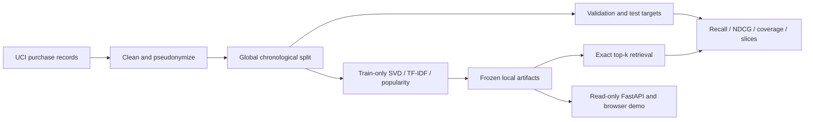

# RecFlow

Local purchase recommendation training, chronological evaluation, and a read-only FastAPI/browser demo.

## What is actually trained

Binary customer-product purchases are transformed by inverse-square-root customer activity weighting. A seeded randomized rank-32 SVD learns collaborative product vectors from training events. A separate title TF-IDF model and unique-buyer popularity baseline are fitted on exactly the same training catalog. Retrieval is exact dot-product scoring, not an approximate vector database. No LLM API or GPU is required.

## Run on Windows / Python 3.11

```powershell
cd "D:\AI-Projects\outputs\RecFlow"
$env:OPENBLAS_NUM_THREADS="2"
$env:OMP_NUM_THREADS="2"
py -3.11 -m venv .venv
.\.venv\Scripts\python.exe -m pip install -r requirements-lock.txt
.\.venv\Scripts\python.exe -B prepare.py
.\.venv\Scripts\python.exe -B train.py
.\.venv\Scripts\python.exe -B -m unittest discover -s tests -v
.\.venv\Scripts\python.exe -B -m uvicorn app:app --host 127.0.0.1 --port 8526
```

Open http://127.0.0.1:8526. API docs: /docs. Choose a pseudonymous demo buyer, compare methods, or enter product words for explicit content preferences. Models load once at application startup; training is not an HTTP operation. Missing artifacts fail startup rather than return fake recommendations.

`python -B check_api.py` exercises the saved model through in-process HTTP. It is not a browser-layout test or HTTP load benchmark. Unit tests use explicitly synthetic tiny fixtures. Actual aggregate data measurements are written only by train.py. requirements-lock.txt pins the tested package versions; requirements.txt records allowed direct dependency ranges.

## Evaluation protocol

Train before 2011-09-01; validate before 2011-10-15; test thereafter. Fixed dates, one seed, no validation/test tuning or retraining. Title snapshots and catalog are derived only from training. Evaluation excludes products already purchased in train and uses every future distinct target, including unavailable cold products. Users with no remaining targets are explicitly omitted. Cold-user slices fall back to popularity and are reported separately. Catalog coverage and top popularity-quintile exposure describe tradeoffs. Offline timing is sequential local scoring, not an HTTP load benchmark. Scores are not calibrated probabilities.

Cold products cannot be retrieved until the next model rebuild; content query fallback handles new users with expressed preferences, not arbitrary unseen products. Catalog membership is a training purchase observation, not a stock-availability record. Repeat-purchase recommendations are intentionally out of scope. Historical buyers are not a proxy for current shoppers; missing/implicit feedback and selection bias limit conclusions.

See reports/evaluation.json and reports/RESULTS.md after training. Negative results must remain visible; do not claim the collaborative model beats popularity unless the measured slice supports it. No business lift, production deployment, authentication, online experimentation, or privacy guarantee is claimed. Bind locally only. New buyers in the demo are supplied IDs, not live customer sessions.

## Data and attribution

Chen, D. (2015). Online Retail [Dataset]. UCI Machine Learning Repository. https://doi.org/10.24432/C5BW33. Source: https://archive.ics.uci.edu/dataset/352/online+retail. Dataset license: CC BY 4.0, https://creativecommons.org/licenses/by/4.0/ . No endorsement is implied.

Download source and observed archive SHA-256 are saved in private/data-source.json and copied into evaluation evidence. The checksum records the downloaded version; it is not an independently published upstream integrity signature. The downloader uses HTTPS and does not execute dataset content. Processing drops cancellations, nonpositive quantities/prices, missing customer IDs and nonnumeric stock codes, deduplicating invoice/product/buyer lines. These filters do not fully reconcile returns against original sales. Raw IDs are replaced by deterministic demo pseudonyms; these are linkable and not cryptographic anonymization. Country and other demographic features are not used. Data, models and buyer-level artifacts stay ignored under private/; only aggregate reports should be published.

## Architecture



Project code: MIT (LICENSE). Data has its separate CC BY 4.0 license above.
